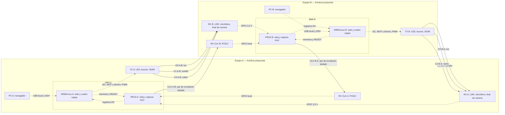

# ADR-0001 — Frontera de nodos y reloj

## 1. Identificador

**ADR-0001 / T01 / TRAMA 3 / CC VIII.** Responsable: Erwin. Revisor previsto: Adrián. Complementa v3.0, no la sustituye.

## 2. Fecha

Redacción y revisión documental: **2026-10-27**, Guatemala. Plan histórico: 2026-10-13, una hora-persona estimada. No se atribuye ejecución a esa fecha ni se declara una hora real consumida.

## 3. Estado

**Propuesta documentada, en revisión.** Faltan revisión de Adrián y respuestas del auxiliar (§15). No implica implementación ni validación experimental.

## 4. Contexto

Se dispone de dos BBB Black. El usuario confirmó luz, sonido y tensión en nylon, y placa perforada soldable como montaje preferido por el auxiliar. El enunciado exige transmisores y receptores replicados en ambos equipos [R1, p. 8]. La aclaración del auxiliar permite cablear sólo el canal de frecuencia; Erwin confirma en esta conversación la aprobación docente del par de reloj por sentido y de las uniones manguera/nylon (registro: 2026-10-27). El PC USB local sigue pendiente.

## 5. Problema

Delimitar equipos, rutas del texto y responsabilidades temporales. Evitar que USB, I2C o reloj sean un transporte alternativo A–B, o que una decisión de diseño se confunda con aprobación docente o resultado experimental.

## 6. Requisitos y matriz de cumplimiento

**D:** confirmado documentalmente. **P:** decisión provisional técnicamente fundamentada. **A:** pendiente de aprobación del auxiliar. **V:** pendiente de validación física en otra tarea. Una fila puede tener varias categorías; D no significa implementado.

| Punto | Evidencia o decisión | Clasificación |
|---|---|---|
| Dos equipos independientes | Dos BBB declaradas, una por nodo [R1 pp. 1, 9; R4 M01] | D; V: arranque/alimentación |
| Cuatro canales por dirección | C0/C1/C2/CLK, dentro del rango oficial 3–8 [R1 p. 4] | D: rango; P: selección |
| Tres medios no convencionales | Luz, sonido y tensión en nylon seleccionados | D: selección y aprobación de unión física comunicada por Erwin; V |
| Un reloj por sentido | Un par de excitación y PC817 por dirección | D: aprobación comunicada por Erwin; V |
| Comunicación bidireccional | N transmisores y N receptores por equipo [R1 p. 8] | D: requisito; V |
| USB exclusivamente local | PC terminal; BBB procesa todo el protocolo | P; A: frontera; V |
| Cuatro capas en BBB | ARM y controlador PHY interno en PRU0 | D: cuatro capas; P: reparto; V |
| ACK/NACK por medios de retorno | Misma PHY del sentido opuesto [R2 caps. 11, 14] | P; V |
| Sin ruta convencional A–B | Sin redes compartidas, puentes ni USB entre BBB | P: restricción operativa; V |
| Protección GPIO | Drivers, 3,3 V y reloj aislado; MCP no es aislamiento galvánico | P; V |
| ARM/PRU/GPIO | Propietario único por función y READY indexado | P; V |

No se cambian medios, presupuesto ni trama. **No se necesita adquirir ESP32:** PRU0 ya es parte de cada BBB y realiza la función temporal prevista.

## 7. Arquitectura propuesta

Dos nodos simétricos, cada uno con ARM/Linux, PRU0, interfaz local, tres emisores, tres receptores y reloj TX/RX. Los 54 bits de cada trama se reparten en 18 tripletas, una posición por medio; el receptor reconstruye el orden fijo. La fabric es una función lógica interna, no un switch de red ni selección del medio más rápido [R2 caps. 9–11]. Todos los tipos de trama, incluidos ACK/NACK, pasan por esta PHY.

| Canal | A → B | B → A | Cruce de frontera |
|---|---|---|---|
| C0 | LED A → LDR/comparador B | LED B → LDR/comparador A | Luz en dos tubos opacos independientes |
| C1 | Buzzer A → micrófono B | Buzzer B → micrófono A | Sonido en dos mangueras independientes |
| C2 | SG90 A → final de carrera B | SG90 B → final de carrera A | Tensión en dos hilos de nylon y retorno mecánico |
| CLK | PRU A → PC817 B | PRU B → PC817 A | Dos circuitos de excitación, dos hilos por circuito |

Son **ocho canales unidireccionales**: seis de datos y dos de reloj. Los seis medios de datos no son seis cables eléctricos. Hay **cuatro conductores externos de reloj y dos PC817 en total**.

## 8. Frontera de cada nodo

**Equipo A:** PC A terminal, BBB A (ARM y PRU0), placa perforada A, drivers, emisores/receptores A, fuentes locales y fijaciones. **Equipo B:** los mismos elementos con identidad B. La BBB es la unidad que procesa el protocolo; el PC es un periférico de interacción, sujeto a aceptación de esta frontera por el auxiliar.

Son internos: USB PC–BBB, túnel SSH, memoria ARM–PRU, I2C BBB–MCP23017, PWM/driver/servo, conexiones de sensores, alimentación y GND local. Cada placa perforada soldable se conecta a su BBB por arnés y queda físicamente separada; no se adopta protoboard como montaje final.

Sólo cruzan A–B los medios de §7. Mangueras, tubos y nylon unen físicamente los nodos sin conductor eléctrico de datos ni retorno metálico común. Se prohíben rutas de chat por Ethernet, Wi-Fi, Bluetooth, USB entre BBB, PC compartido, hub USB común, red compartida, puente, reenvío IP o servicio externo. Tampoco se usa el reloj para reemplazar un medio de datos.

Por nodo se conserva fuente propia para BBB y otra para actuadores. Sus GND se unen **localmente** según v3.0; sus positivos de 5 V no se puentean. No se une GND A con GND B. El PC817 está montado en la placa receptora, pero su LED pertenece eléctricamente al dominio del emisor: frontera física y barrera galvánica no son equivalentes.

**Precisión necesaria:** el opto evita compartir GND por el reloj, pero no garantiza aislamiento global. Cargadores de PC, fuentes de banco e instrumentos pueden crear un camino externo. La demostración requiere terminales a batería o una alimentación verificada sin unión A–B; no se levantan tierras de protección. La validación eléctrica posterior incluirá USB, fuentes e instrumentos, además del reloj.

## 9. Interfaz USB local

El servidor escucha en `127.0.0.1` de cada BBB; el navegador accede mediante túnel SSH por su USB gadget. El extremo local del túnel se limita también a loopback. La terminal solicita acciones a su BBB; no entrega datos a la BBB opuesta. Aplicación, presentación, enlace y PHY residen en la BBB; PRU es controlador interno de PHY. Los recursos web serán locales, sin CDN: el sistema se diseña para funcionar sin Internet.

Para la demostración: desactivar conexiones de red ajenas al USB local en ambos PC/BBB, desconectar Ethernet y evitar conexión compartida de Internet, puentes y reenvío. Cada PC se conecta sólo a su BBB. El protocolo debe ejecutarse como servicio independiente del navegador y SSH.

Desconectar el PC elimina la interfaz, pero la BBB con fuente propia continúa lo ya aceptado y las recepciones. Reiniciar el navegador consulta el estado sin reenviar automáticamente el texto. Las colas son acotadas y en RAM: no se promete persistencia ante reinicio de BBB; éste requiere nueva sesión y tratamiento de entregas inciertas.

Demostración futura de exclusividad: inventariar interfaces/rutas, operar sin Internet, correlacionar registros de trama/ACK y actividad física; interrumpir individualmente un medio o CLK durante una trama y comprobar borrado/timeout, sin entrega confirmada por otra ruta. Mostrar sólo el chat funcionando no demuestra exclusividad. Estas pruebas no se realizaron en T01.

Respaldo: pantalla HDMI y periféricos locales en cada BBB, con el mismo servidor/protocolo. Requiere verificar recursos/pines en tareas posteriores; no reemplaza ahora la arquitectura principal.

## 10. Diseño del reloj

Un canal lógico CLK transmite instantes de adquisición de los tres bits del símbolo. Dos conductores cierran una única corriente de ida/retorno; no son dos señales independientes.

A → B: PRU A → resistencia propuesta 390 Ω → ánodo del PC817 montado en B; su cátodo vuelve por el segundo conductor a GND A. El transistor del opto usa únicamente 3,3 V/GND B. El otro sentido replica el circuito intercambiando dominios. **Nunca conectar el cátodo remoto a GND receptor.**

Se conservan valores de v3.0: PC817 pines 1/2 LED, 4 colector, 3 emisor; pull-up receptor 4,7 kΩ y serie de entrada 1 kΩ. Corriente, niveles, variante real y márgenes se verificarán después. La salida receptora invierte: TX activo produce nivel eléctrico RX bajo. Normalizar polaridad antes de interpretar flancos. En reposo: TX lógico 0, LED apagado, RX eléctrico alto y reloj normalizado 0.

Cada dirección necesita su propio calendario porque puede iniciar transmisiones independientemente: A temporiza RX B y B temporiza RX A. No hay reloj global ni sincronización de relojes de pared Linux. Una PRU atiende TX y RX locales con dos máquinas de estados cooperativas y acotadas, no dos hilos físicos independientes. La simultaneidad debe medirse.

Perfil inicial [R2 caps. 5A/10]: **T=250 ms**. ARM ordena salidas al inicio y publica READY antes de 10 ms. CLK lógico alto entre 190 y 225 ms. Óptica/mecánica: cinco muestras a +5…+9 ms del flanco recibido. Acústica: dos ventanas consecutivas de 10 ms desde ese flanco. Datos estables hasta fin del ciclo. Son objetivos del diseño, no tiempos medidos.

Reposo/separación: actuadores en 0 y CLK inactivo al menos 2T. Inicio: SYN `111,000,111,000` y SFD `101,010`; luego exactamente 12 símbolos de cuerpo: 18 en total. No buscar SFD dentro del cuerpo. Fin de trama por longitud fija y vuelta a reposo; el fin de mensaje lo indica END existente, no un pulso especial.

El reloj lleva **sólo sincronización**: período y ancho fijos por perfil; no codificar texto, tipos, ACK ni bits en frecuencia, duty cycle, pausas o cantidad de pulsos dependiente del contenido. Reposo/actividad revelan cuándo hay tráfico, pero no se usan como otro código. SYN/SFD y campos viajan por C0/C1/C2. T=500 ms sólo se adopta mediante el procedimiento de perfil de v3.0, fuera de una trama y con recalibración; no se declara validado.

Pulso perdido, período fuera de ±5 %, ventana incumplida o sensor ambiguo invalidan la trama: no inventar bits. Receptor espera silencio 2T y nuevo SYN/SFD. READY tardío impide el pulso TX y aborta la trama, sin bloquear RX local. Enlace conserva copia para timeout/reintento. Nunca confirmar positivamente una trama incompleta ni inventar identidad para ACK/NACK de una cabecera irrecuperable. Cable abierto o fallo no habilitan transporte convencional.

**Aprobación docente registrada:** Erwin confirma que el auxiliar aceptó la pregunta 1, incluido un par como un CLK y su réplica por sentido. Falta validación física en tareas posteriores.

## 11. Distribución ARM/PRU/GPIO

| Recurso | Responsabilidad | Límite |
|---|---|---|
| ARM/Linux | Web, cuatro capas, CRC, sesiones/ARQ, buffers y reparto/reconstrucción PHY | No fija flancos por temporizador Linux |
| ARM/I2C | GPA0/GPA1 en una operación y orden PWM cuando cambia C2 | Publica READY después de ambas órdenes |
| PRU0 | Calendario TX, CLK TX/RX, captura GPIO, ventanas y conteo acústico | No web, colas de aplicación ni segundo controlador I2C |
| MCP23017 | Salidas hacia drivers de LED y buzzer, por I2C local | No aislamiento galvánico ni protección de todas las entradas BBB |
| PWM hardware | Pulso del SG90 configurado por ARM, mediante driver previsto | Servo no alimentado por GPIO ni PWM por bit-banging Linux |

Contrato conceptual: PRU define ciclo/índice esperado; ARM prepara tripleta de generación vigente y publica contenido antes de READY, con orden de memoria definido. PRU acepta sólo generación/índice actuales y READY oportuno; nunca reutiliza un indicador antiguo. La trama permanece inmutable durante cada intento. RX publica registros con tiempo/estado en buffer acotado; overflow es error explícito. Selección concreta de memoria/notificación/remoteproc/RPMsg queda para implementación.

**READY significa órdenes completadas, no servo estabilizado.** PWM de 20 ms y respuesta del medio quedan dentro del margen hasta 190 ms. Linux no garantiza el plazo de 10 ms bajo toda carga: medirlo y abortar ante incumplimiento. Esperar ARM no debe impedir RX. El muestreo objetivo de 10 µs también exige medir anchura real de pulsos acústicos y pérdida de eventos.

Pines conservados, aún sin configurar: P8_11 CLK TX (PRU0 R30.15), P8_15 CLK RX (R31.15), P8_16 acústico (R31.14), P9_27 óptico (R31.5), P9_24 final de carrera (R31.16), P9_14 PWM, P9_19/P9_20 I2C. T04/T06/T08 verificarán pinmux, UART/otros conflictos, recursos y niveles. Ninguna entrada BBB recibe 5 V.

El KY-037 puede dar pulsos, no un “1” sostenido. Se conserva el conteo en dos ventanas para decidir presencia de sonido; desacuerdo equivale a borrado. Consultar aceptación académica de esa demodulación. Si se exige nivel estable, revisar posteriormente envolvente/comparador; no afirmar que componentes adicionales estén incluidos en la BOM ni comprarlos en T01.

## 12. Diagrama general

Punteadas: conexiones internas. Continuas entre cajas: los ocho canales externos. TX/RX agrupan circuitos independientes, no un bus eléctrico entre nodos.

Cada flecha CLK resume resistor, ida y retorno al emisor; no es un solo hilo ni unión GND–GND. Fuentes omitidas por legibilidad, definidas en §8. ACK/NACK utilizan los medios de retorno dibujados.

## 13. Alternativas consideradas

| Alternativa | Resolución |
|---|---|
| Añadir ESP32 | Innecesario: agrega otra frontera; conservar PRU interno |
| Reloj generado por Linux | No elegido: PRU controla instantes críticos; Linux conserva plazo READY |
| Reloj con GND común | No elegido: contradice separación de dominios |
| Un reloj global | No elegido: acopla calendarios y exige rediseño |
| HDMI/periféricos en BBB | Respaldo sujeto a disponibilidad y pruebas posteriores |
| Servidor/protocolo en PC | No elegido: cambia frontera de procesamiento |

## 14. Decisiones adoptadas en esta propuesta

Conservar BBB/PRU0, medios, cuatro canales por sentido, USB local, fuentes por nodo y placa soldable. Preservar trama/colas/perfil v3.0. Formalizar inversión CLK, dominio eléctrico del LED remoto, READY y prohibición de rutas alternativas. Reloj y uniones manguera/nylon tienen aprobación docente comunicada por Erwin. Las demás interpretaciones pendientes no se consideran aprobadas; falta revisión de Adrián.

## 15. Confirmaciones pendientes

Adrián debe revisar el ADR. Pendientes del auxiliar: PC USB sólo terminal y conteo acústico frente a nivel sostenido. Las preguntas 1 y 2 (reloj y uniones físicas) están aprobadas según confirmación de Erwin. La bidireccionalidad general ya la exige R1 p. 8: no se vuelve a preguntar y tampoco se repiten las preguntas 1 y 2 ya aprobadas. [Consulta preparada](../consultas/aclaraciones-auxiliar.md).

## 16. Consecuencias técnicas

El medio lento limita los tres canales. PRU define temporización, pero no elimina plazos Linux ni asegura rendimiento sin pruebas. ACK/NACK necesitan retorno experimental operativo. No se contempla degradación automática a dos medios ni enlace convencional de respaldo.

## 17. Riesgos

| Riesgo | Tratamiento posterior |
|---|---|
| Rechazo de USB o conteo acústico | Obtener respuestas restantes antes de congelar T01; revisar ADR si cambia |
| Unión accidental GND | Revisar fuentes, PC e instrumentos en alimentación/integración |
| READY tardío, estado obsoleto, pérdida RX | Generación/índice, estados no bloqueantes y medición T06/T12/P09 |
| Sonido ambiguo/diafonía | Mangueras independientes, umbrales y ensayos T09/T11 |
| Servo lento, rebote, óptica desalineada | Caracterizar antes de aceptar T=250 ms |
| Pin ocupado, variante o 5 V en entrada | T04/T07/T08; este ADR no autoriza energizar |
| Cronograma histórico sin avances | No suponer tareas terminadas; revisar impacto fuera de T01 |

## 18. Criterios definitivos de aceptación

- [x] Fronteras, conexiones y ocho canales documentados.
- [x] Reparto funcional, reloj y fallos revisados por consistencia documental.
- [x] ADR, README, estructura mínima y consulta preparados.
- [ ] Adrián registra revisión y resolución de observaciones.
- [x] Preguntas 1 y 2 aprobadas por el auxiliar según confirmación de Erwin.
- [ ] Auxiliar responde preguntas 3 y 4; registrar respuesta y ajustar ADR si corresponde.
- [ ] Erwin registra aceptación y fecha real de cierre sin borrar fecha planificada.

Las mediciones de T06/T11/T12 no son necesarias para cerrar esta decisión documental, pero su cierre no las acredita. Estado actual recomendado: **En revisión, 85 % orientativo**, por faltar revisión humana y aprobación externa. No es medición de horas ejecutadas.

## 19. Relación con las tareas siguientes

| Tarea | Dependencias exactas del tracker | Información recibida de T01 |
|---|---|---|
| T02 inspeccionar BBB | Ninguna | Dos placas, fuente propia, Mini USB y PRU; siguiente disponible |
| T03 lotes/cotizaciones | T01; T02 | Medios duplicados, PC817 y placa soldable |
| T04 Debian/pinmux | T02 | Pines, reparto ARM/PRU y USB local |
| T05 comprar | T03 | Arquitectura sin ESP32; no se presume compra |
| T06 PWM/PRU | T04 | PWM hardware, reloj invertido, TX/RX PRU |
| T07 variantes | T05 | PC817, módulos, paso y conectores |
| T08 alimentación | T04; T07 | Dominios, GND local y caminos externos |
| T51/T52 distribución/revisión | T07; T08 | Zona aislada y arnés; sin diseñarlos ahora |
| T09/T10 medios/reloj | T51; T52 | Frontera y temporización |
| T53/T54 cerrar placas | T09; T10 | Arquitectura simétrica y revisión cruzada |
| T11/T12 caracterización | T53; T54 | READY, latencias, ventanas y simultaneidad |

Dependiente **directa** de T01: T03. **Indirectas:** T05, T07, T08, todas T09–T50 y T51–T54. T02/T04/T06 no dependen de T01 en el grafo actual, aunque usan su información. No se añaden dependencias al Excel.

Las fechas anteriores al 27/10 son planificación histórica, no evidencia de trabajo. Retrasar T01 afecta T03 y su cadena; no impide T02. No se inicia ninguna tarea ni se reprograma el calendario en esta sesión.

## 20. Referencias

- **R1:** `Proyecto_-_Capa_Fisica_.pdf`, pp. 1–4 (equipos/canales/reloj), 5–6 (enlace/interfaz), 7–9 (medios, réplica y capas).
- **R2:** `CCVIII_TRAMA3_Documento_Tecnico.pdf`, v3.0, caps. 1–2 (pp. 3–4); 5/5A (12–13); 6/7/7A (14–16); 8/9/10 (19–21); 11 (22); pruebas/diagnóstico (29–30); 21 (32); 24 (35).
- **R3:** `CCVIII_Tracker_y_Cronograma.xlsx`, `Tracker maestro`, encabezado fila 5, T01 fila 6, T02–T08 filas 7–13, montaje/validación filas 14–21 y grafo completo de 54 tareas.
- **R4:** `CCVIII_Materiales_y_Compras.xlsx`, `BOM maestra`, M01/M02/M11/M23/M24/M25/M28–M34 y M35–M41.
- **R5:** Capturas del auxiliar aportadas por el usuario: sólo reloj cableado y recomendación de expansor. No aprueban las consultas pendientes.

Ubicaciones y huellas: [referencias](../referencias/README.md). No se reinició investigación ni se modificaron los originales.

Actualización de aprobación, 2026-10-27: fuente adicional R6, mensaje de Erwin en esta conversación confirmando que el auxiliar aprobó las preguntas 1 y 2. No se inventa cita literal ni fecha de la respuesta docente.
