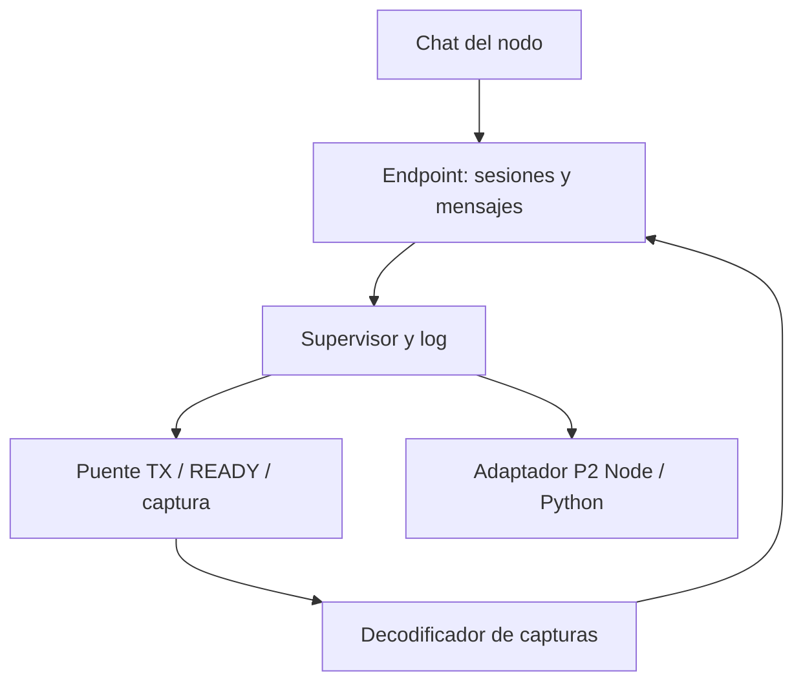

# TRAMA3 revision 102: base del informe de software

Fecha: 16 de noviembre de 2026. Estado: implementacion y pruebas en PC.
Este documento sirve de base del entregable tecnico; no es acta de aceptacion
fisica ni sustituye la guia del proyecto o los criterios del tracker.

## Arquitectura implementada

Cada endpoint conserva unicamente su estado de protocolo. En el banco de PC,
dos supervisores comparten el planificador del medio simulado. El planificador
entrega eventos de reloj/datos al receptor; no entrega directamente el texto.



| Componente | Responsabilidad | Evidencia disponible |
| --- | --- | --- |
| endpoint.cjs | HELLO/COMMIT, secuencia, mensajes, ACK/NACK, reintentos y duplicados | Pruebas funcionales y banco de fallos |
| stream.cjs | Reconstruccion desde eventos, control de secuencia/epoch y tiempos | Eventos sinteticos y pruebas de rechazo |
| supervisor.cjs | Preparacion de salidas, TX, parada, limpieza y diario JSONL | Pruebas con puente simulado |
| native/service.c | Modelo portable de captura/TX, guardas y watchdog | Pruebas C en PC; no firmware TI validado |
| native/host.c | Acceso ARM a memoria compartida y puente de proceso | Fuente; compilacion y ejecucion ARM pendientes |
| p2-adapter.cjs / p2-worker.py | Proceso persistente para operaciones P2 | Intercambio completo con backend simulado |
| p2.py | MCP23017 y PWM mediante backend Linux inyectable | Pruebas de IO simulado; medios reales pendientes |
| chat-session.cjs / node-web.cjs | Cola, estados, vistas por nodo y descarga del log | Pruebas HTTP y uso del banco por el usuario |

## Comportamiento y limites

El runtime funciona a 1 Hz; rechaza cambios de frecuencia que aun no implementa.
Admite CRC SMBUS, AUTOSAR, SAE-J1850 y MAXIM-DOW, y texto UTF-8/Windows-1252.
El chat elige CRC y codificacion al crear la sesion. Cada mensaje admite hasta
1024 bytes y cada nodo hasta ocho mensajes pendientes/enviandose.

Un mensaje se muestra confirmado despues de recibir su confirmacion final.
Si se pierde ese ACK, el receptor reconoce el END repetido y confirma sin
volver a entregar el texto. Agotar cuatro intentos implica fallo con entrega
incierta: no demuestra que el receptor nunca haya visto el mensaje.

Los logs incluyen origen, nodo, secuencia de registro, tiempo de protocolo,
tramas, capturas, respuestas y parada. Los reportes de simulacion declaran
physical_status=NOT_TESTED. Una inyeccion deliberada aparece como INJECTED_FAULT.
Los hashes vinculan el reporte con los archivos utilizados; no certifican
identidad fisica, calibracion, exactitud del reloj ni ausencia de manipulacion.

## Matriz de pruebas reproducibles

Ejecutar desde cc8-trama3, con un directorio destino nuevo:

```powershell
node .\repo\software\runtime102\fault-suite.cjs .\evidencias\runtime102-fallos-01
```

| Escenario | Resultado requerido |
| --- | --- |
| Sin fallo | Entrega bidireccional exacta y limpieza sin errores |
| Perdida de ACK de DATA | Reintento, duplicado reconocido y entrega unica |
| Perdida de ACK de END | Reintento sin segunda entrega del texto |
| Corrupcion de DATA con CRC original | NACK, reintento y entrega correcta |
| Ausencia de toda transmision A | Agotamiento acotado: tres reintentos, cuatro intentos |
| Salida del puente | Parada por BRIDGE_EXIT |
| Hueco en secuencia de captura | Parada por SEQUENCE_GAP |
| Cambio de epoch de captura | Parada por EPOCH_CHANGED |
| Fallo al escribir salidas | Parada por OUTPUT_IO |
| Preparacion tardia | Parada por OUTPUT_PREPARE_LATE |

Un ensayo puede aprobar cuando la sesion termina en FAIL: para un fallo fatal,
se comprueba que pare por la razon esperada. report.json distingue status de la
sesion y verdict del ensayo. Tambien comprueba limpieza e inyeccion observada.
Cada caso produce A.jsonl, B.jsonl y summary.json; REPORTE.md resume el conjunto.
La corrupcion es sintetica: no acredita la interferencia fisica exigida en la demo.

## Preparacion de la demostracion

1. Arrancar el chat sin fallos y enviar texto en ambos sentidos; conservar logs.
2. Arrancar una sesion nueva con corrupt-data, enviar desde A y observar NACK y
   reintento en diagnostico. El texto debe llegar una sola vez a B.
3. Repetir con drop-end-ack; observar reintento en A y duplicado reconocido en B.
4. Ejecutar el banco automatizado y revisar que todos los verdict sean PASS.
5. Presentar estos resultados como pruebas de software, separados de las
   evidencias T06 previas y de las futuras mediciones P2.

## Pendientes para el cierre fisico

- Propietario de recursos y lanzador por BBB: exclusividad IEP/PRU/PWM/I2C,
  carga de firmware, pinmux, parada y restauracion verificables.
- Compilacion conjunta de host y firmware ABI3, mapa/ensamblador TI y ejecucion
  en Debian ARM. El ZIP contiene fuentes, no binarios certificados.
- Calibracion independiente de BBB-A/BBB-B y P2: polaridades, posiciones del
  servo, tiempo de asentamiento, ventana acustica y filtros de recepcion.
- Medicion de latencias Node/ARM y tiempos reales del puente; READY solo
  confirma escritura, no asentamiento del medio.
- Chat conectado a un nodo fisico por BBB; el banco actual tiene ambos nodos
  simulados en un unico proceso. HTTP no es el transporte fisico del protocolo.
- Comunicacion entre equipos e interferencia real, con capturas y resultados.

T06 conserva la evidencia ya obtenida en ambas BBB. T08 no se cierra con este
banco. No se modifican filas ni fechas de la calendarizacion original mediante
este documento; el cierre de cada tarea requiere contrastar su criterio exacto.
